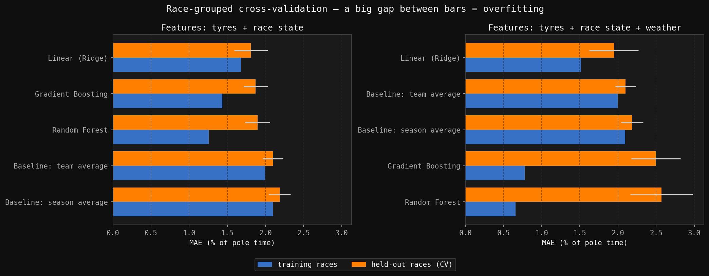
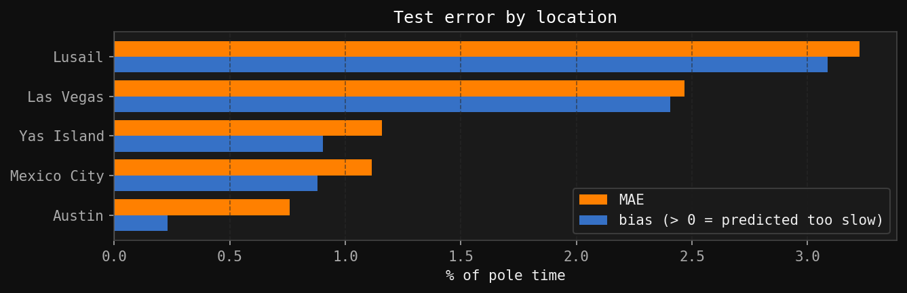

# F1 race pace: telemetry analysis and lap-time prediction

Can we predict a Formula 1 race lap time at a track the model has never seen, using only what is
known at the start of the lap: tyre compound and age, team, and how far into the race we are?

Using every lap of the 2024 season (24 races, 26,661 laps), a simple linear model predicts lap
times on the last five races of the season to within **1.39 s per lap (1.64% of pole time)**.
That is **20% lower error than the best baseline**. The model was selected before the
test races were looked at.

The full analysis, with explanations, is in [notebooks/analysis.ipynb](notebooks/analysis.ipynb).

## Results

Test set: rounds 19–24 (Austin, Mexico City, Las Vegas, Lusail, Abu Dhabi; São Paulo removed
because qualifying was wet).

| Model | MAE (% of pole) | MAE (s / lap) |
|---|---|---|
| Baseline: season average | 2.11 | 1.80 |
| Baseline: team average | 2.04 | 1.73 |
| **Linear (Ridge) — selected by cross-validation** | **1.64** | **1.39** |
| Random Forest | 1.60 | 1.35 |
| Gradient Boosting | 1.61 | 1.37 |



**Main findings**
- **Choosing the right target removes most of the problem.** Raw lap times can't be compared
  across tracks, so the target is the race lap time as a % above that weekend's pole time. The pole
  time is known before the race, so nothing leaks.
- **Weather features make tree models overfit.** Each race has its own temperature and humidity,
  so Random Forest and Gradient Boosting use them to recognise the track and memorise its pace
  (training error 0.7%, error on held-out races 2.5%). Validation that holds out whole races
  catches this; a random split would not.
- **What's left is mostly a track effect.** In every test race the model predicts laps too slow,
  most at Lusail and Las Vegas (2.4–3.1 points), because their race pace was unusually close to
  pole. Nothing in the current features describes the track.



## Method

1. **Telemetry exploration** (Monaco 2024 qualifying): speed map, braking/throttle zones,
   driver comparison and sector gaps.
2. **Dataset:** lap times, tyre stints, teams and weather from OpenF1; official qualifying
   times from Ergast.
3. **Cleaning:** each rule is logged with the number of laps it removes
   ([results/cleaning_report.csv](results/cleaning_report.csv)):
   - lap 1, pit in- and out-laps
   - races with a wet qualifying session, detected from the tyres used
   - laps on wet-weather tyres
   - safety-car laps (> 20% off pole)
4. **Split by time:** rounds 1–18 for training and model selection, rounds 19–24 used only once
   for the final evaluation.
5. **Model selection:** 5-fold cross-validation grouped by race, comparing two baselines, Ridge,
   Random Forest and Gradient Boosting on two feature sets.
6. **Error analysis:** permutation feature importance, residuals, error and bias per race.

## Limitations and next steps

- One season and 17 training tracks; the test set has only 5 races, so its scores are noisy.
- Traffic, fuel load and car setup are not modelled (`race_progress` stands in for fuel).
- The 20% safety-car cut-off is a rule of thumb.
- Next steps:
  - Add each track's race pace from the previous season (aimed at the largest source of error).
  - Add track characteristics derived from telemetry.
  - Train and evaluate across several seasons.

## Project structure

```
src/
  data_loader.py          FastF1 telemetry + OpenF1/Ergast season dataset (with on-disk cache)
  feature_engineering.py  cleaning rules, target, features, time-based split
  model_trainer.py        baselines, models, race-grouped CV, evaluation, error analysis
  visualizer.py           all charts
  main.py                 runs the whole pipeline
notebooks/analysis.ipynb  the analysis with explanations and outputs
data/processed/           datasets used by the analysis (CSV)
results/                  output tables (cleaning report, CV, test leaderboard, error by race)
visualizations/           output charts
```

## How to run

Requires Python 3.11+.

```bash
python -m venv .venv && source .venv/bin/activate
pip install -r requirements.txt

python src/main.py                 # full pipeline: tables to results/, charts to visualizations/
jupyter notebook notebooks/analysis.ipynb
```

The processed datasets are included in `data/processed/`, so both commands run without
downloading anything. To rebuild the season dataset from the APIs, call
`load_season_race_laps(2024, force=True)`. Note: F1's live-timing server now rejects
new FastF1 downloads, so the Monaco telemetry is shipped as a CSV.
